<div align="center">


# KeiroLake

**A private data lake and AI gateway that runs on your own hardware.**

Tables, documents and offline libraries in one place. Local models answer first. Reach it all, including your local
models, from any device over a private link, through an OpenAI-compatible API and MCP.

[](https://github.com/KumarRoushan9234/Keirolake/releases/latest)
[](https://github.com/KumarRoushan9234/Keirolake/actions/workflows/release.yml)
[](https://github.com/KumarRoushan9234/Keirolake/releases)

[](LICENSE)

[**Website**](https://kumarroushan9234.github.io/Keirolake/) · [**Download**](#install) · [Local models anywhere](#your-local-models-from-anywhere) · [Run it your way](#run-it-your-way) ·
[Features](#features) · [API and MCP](#a-data-layer-for-your-ai-and-apps) · [Security](#security) · [Docs](#documentation)

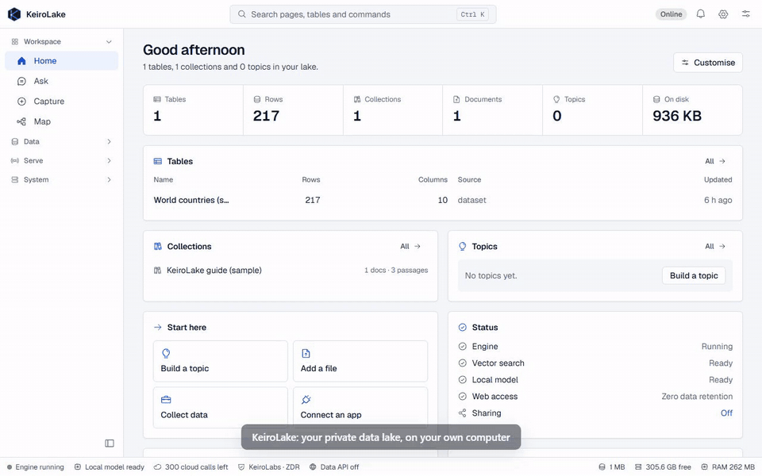

<sub>[Watch it as a video (MP4)](docs/media/demo.mp4)</sub>

</div>

## Why KeiroLake

|                             |                                                                                                                                                              |
| --------------------------- | ------------------------------------------------------------------------------------------------------------------------------------------------------------ |
| **Local first**             | Your data stays in one folder you own. Models on your machine answer first; cloud models only when you allow them, up to a daily limit. Works fully offline. |
| **One lake for everything** | Spreadsheets, PDFs, notes, web pages, public datasets and offline Wikipedia, searchable together by meaning and keyword.                                     |
| **A gateway for your AI**   | OpenAI-compatible `/v1`, a tables API and an MCP server turn your lake into the data layer for any app, script or agent.                                     |
| **Reachable from anywhere** | Home Wi-Fi, a private internet link with no open ports, or your own domain. Keeps answering with the screen locked or the lid closed.                        |
| **Runs your way**           | Desktop app, headless server, one Docker container, an installable web app, or the command line.                                                             |
| **Keeps itself current**    | Signed automatic updates from GitHub Releases. Every push to `main` ships a tested release.                                                                  |

## Your local models, from anywhere

Run Ollama on a home PC with a good GPU, and use those models from your phone, laptop or a cloud agent. Your prompts
and data never touch a third-party AI service.

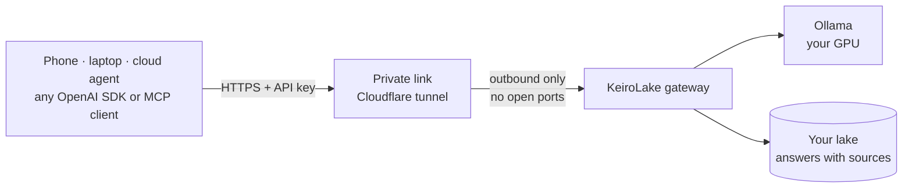

1. **Turn on the link:** Serve → Sharing → **Anywhere** (or `keirolake serve --share internet`).
2. **Make a key** with the `llm` permission: Serve → API keys (or `keirolake keys create my-phone --scope llm`).
3. **Call it** from anywhere:

```python
from openai import OpenAI

lake = OpenAI(base_url="https://<your-link>.trycloudflare.com/v1", api_key="klk_...")
lake.chat.completions.create(model="qwen2.5:7b", messages=[{"role": "user", "content": "Hello from my phone"}])   # a model on your PC
lake.chat.completions.create(model="lake", messages=[{"role": "user", "content": "What do my notes say about pricing?"}])  # grounded in your data
```

`GET /v1/models` lists `auto` (local first), `lake` (answers from all your data, with sources), `lake:<id>` (one
collection or topic), every model in Ollama and your configured cloud models. Streaming and embeddings work.
For a name that never changes, connect your own Cloudflare tunnel (`lake.yourdomain.com`), free on Cloudflare.

## Install

### Desktop app (Windows, macOS and Linux)

Everything in one installer: engine, vector database and interface. No Docker, no administrator rights. Every
version updates itself from Settings → Updates, checked against the project's signature first.

| System                           | Download                                                                          | Install                                                                                                     |
| -------------------------------- | --------------------------------------------------------------------------------- | ----------------------------------------------------------------------------------------------------------- |
| **Windows 10 / 11** (x64)        | [Installer (.exe)](https://github.com/KumarRoushan9234/Keirolake/releases/latest) | Run it. If SmartScreen warns (not code-signed yet): **More info → Run anyway**.                             |
| **macOS 11+, Apple Silicon**     | [aarch64 .dmg](https://github.com/KumarRoushan9234/Keirolake/releases/latest)     | Open it, drag KeiroLake to Applications. First launch: **right-click → Open** (not notarized yet).          |
| **Ubuntu / Debian**              | [.deb](https://github.com/KumarRoushan9234/Keirolake/releases/latest)             | `sudo apt install ./KeiroLake_*_amd64.deb`. Updates install from the app with your password.                |
| **Fedora / RHEL / openSUSE**     | [.rpm](https://github.com/KumarRoushan9234/Keirolake/releases/latest)             | `sudo dnf install ./KeiroLake-*.x86_64.rpm`. Updates install from the app with your password.               |
| **Any Linux**                    | [AppImage](https://github.com/KumarRoushan9234/Keirolake/releases/latest)         | `chmod +x KeiroLake_*.AppImage`, then run it.                                                               |

If macOS says the app "is damaged", it's the quarantine flag on downloads from outside the App Store:
`xattr -cr /Applications/KeiroLake.app` clears it.

Then install [Ollama](https://ollama.com/download). KeiroLake reads your hardware, recommends models that fit, and
installs them in one click. A fresh install includes sample data so you can try everything at once.
Every release lists `SHA256SUMS`; check with `sha256sum -c SHA256SUMS` or `Get-FileHash <file>`.

## Run it your way

| Mode                | For                                   | Start it                                                             |
| ------------------- | ------------------------------------- | -------------------------------------------------------------------- |
| **Desktop app**     | Your own computer                     | Download above                                                       |
| **Headless server** | Home server, NAS, cloud VM: no window | `keirolake serve --share wifi`                                       |
| **Docker**          | One container with everything         | `docker compose -f docker-compose.server.yml up -d`                  |
| **Web app**         | Phones and other computers            | Open your lake's address, then **Install** / **Add to home screen**  |
| **CLI**             | Scripts and automation                | `keirolake status`, `keirolake build "…"`, `keirolake keys create …` |

### Headless server

```bash
git clone https://github.com/KumarRoushan9234/Keirolake.git && cd Keirolake
(cd frontend && npm ci && npm run build)            # the web app it serves
pip install -e backend                               # Python 3.12+
keirolake serve --share internet                     # asks for a sign-in password the first time
```

The engine listens only on a private loopback port with a random token. People reach it through the sharing listener:
the web app needs your password, `/v1` and `/mcp` need an API key. `--share` is `local` (this machine), `wifi`
(HTTPS on your network), `internet` (adds a private link) or `open` (a port you open, with an allow-list).
Add `--keep-awake` on a laptop.

### Docker

```bash
KEIROLAKE_PASSWORD='a long password' docker compose -f docker-compose.server.yml up -d --build
```

Open `https://<this machine>:8443` and sign in. Ollama on the host is reached at `host.docker.internal`; set
`KEIROLAKE_SHARE=internet` for a private link (`docker compose -f docker-compose.server.yml exec keirolake python -m app.cli link`).

### Command line

```text
keirolake serve      Run headless (engine, web app, API, MCP, internet link)
keirolake status     Version, addresses, internet link, running jobs
keirolake link on    Turn the private internet link on (or off, or show it)
keirolake keys       create · list · revoke API keys
keirolake build      "Indian states with capital and population" --rows 30
keirolake tables     Your tables         keirolake sql "SELECT ..."
keirolake ingest     Files, URLs, web searches and websites into a collection
keirolake chat       Ask a collection, with citations
keirolake update     Is there a newer version?
```

The CLI finds a running `keirolake serve` on its own, or uses `KEIROLAKE_URL` and `KEIROLAKE_TOKEN`.

## Features

### Ask your data

Answers with numbered sources (`[1]` your data, `[Z1]` offline libraries, `[W1]` the web) and the model that wrote
them. Choose what to search, whether the web may help and how deep to go. Chats are saved and keep running while you
work elsewhere.

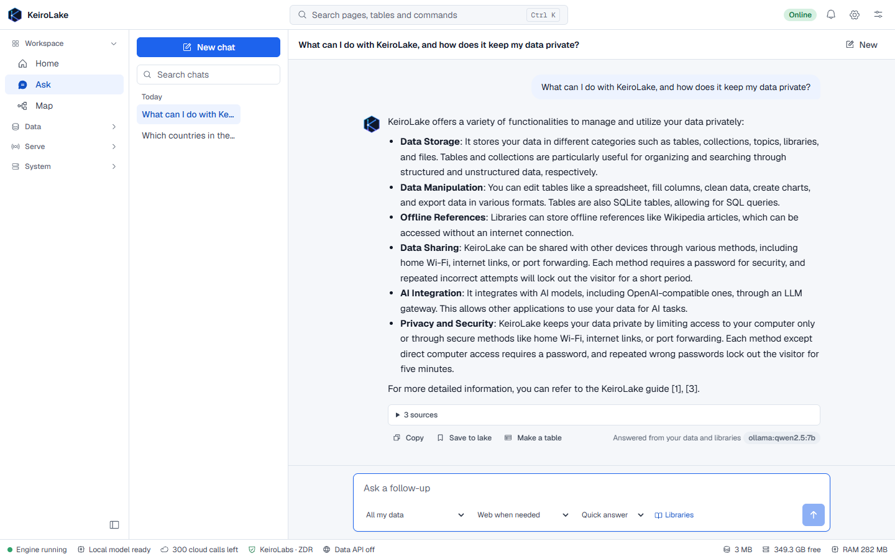

### Build datasets and libraries by talking

Describe a table ("every Indian state with its capital, population and official language") or an offline library.
The AI proposes the columns or sections; you shape them in the chat or edit the plan directly: rename, retype,
reorder, remove. It fills the rows from your collections, offline libraries, the web, or its own knowledge, records
where every cell came from, and marks guesses as low confidence. Then it asks: more rows, another column, or done?
Start from a table you already have to extend it. Every build is kept and keeps running when you leave the page.

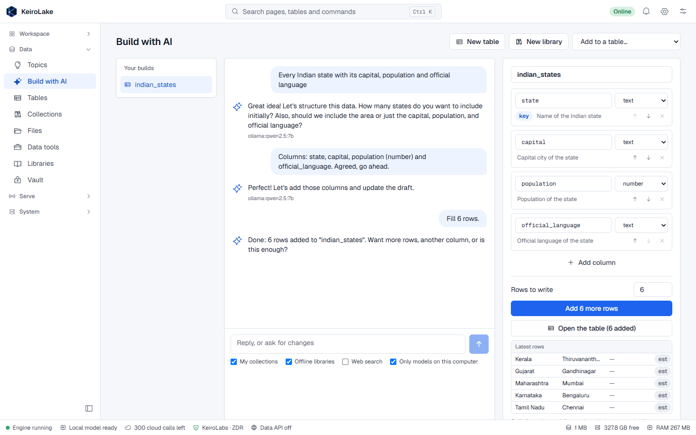

### Work keeps going in the background

Leave a page while something is running and it carries on: model replies, table fills, imports, downloads, asking a
sheet, reading web pages into a table. A notice appears when it finishes, with a button to open the result, and the
bell in the top bar counts everything still running.

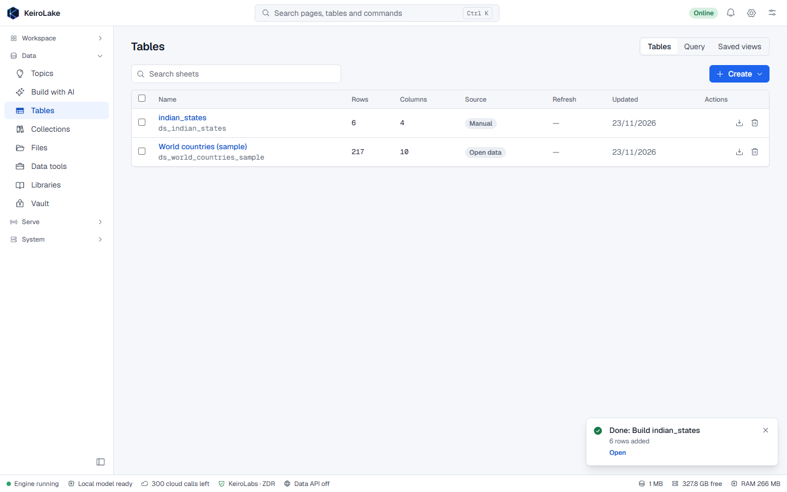

### Monitor markets, world events and cyber threats

A local watch from open sources, off until you switch it on: real top performers among India's large companies (or every
NSE stock, from files you import), earthquakes, disaster alerts and outbreaks, exploited vulnerabilities and new CVEs,
with alert rules, a cited daily brief, and the same data for Claude and ChatGPT through MCP. Prices are real or absent:
KeiroLake says what is missing instead of inventing a report. [How it works](docs/guide.md#monitor-markets-world-events-and-cyber-threats).

### A model for each kind of task

Keep everyday questions on your own computer and hand hard tasks, reports and coding to a stronger model of your choice,
from a live list that says what each model is good for and what it costs.
[How it works](docs/guide.md#a-model-for-each-kind-of-task).

### Capture from your phone

Open your lake on your phone and add it to the home screen. The **Capture** tab puts anything into the lake in one tap:

- **Voice notes**, turned into text on *your* computer by a local Whisper model. The recording never goes to an online
  speech service.
- **Photos of a page**, read by a vision model on your computer when you have one (Qwen-VL, LLaVA, Gemma 3…).
- **Links and text**: a link is saved as its readable page.
- **Share to KeiroLake** from any Android app: a PDF from Files, a page from Chrome, a photo from the gallery.
- **No signal?** Captures wait on the phone and go out when the lake is reachable again.

The microphone button in Ask and Build with AI works the same way, and the phone layout has a bottom tab bar
(Ask, Capture, Build, Tables). Everything lands in a collection called **Captured**, searchable like any other.
Installing the app and using the microphone need the private internet link or your own domain (browsers only allow
them on trusted HTTPS).

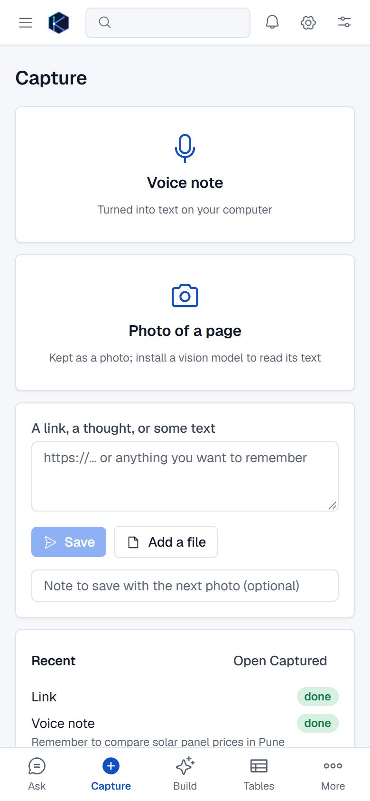

### Tables

Every table is a sheet: edit, filter, clean, chart, export (CSV, Excel, JSON, PDF), ask it a question, fill a column
with the local model, run read-only SQL across all tables, and save a query as a view your apps can read.

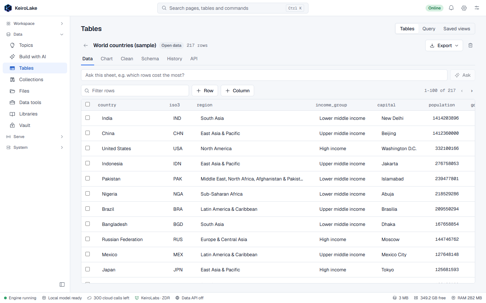

### Collect data

- **Open data, free, no key:** OpenAlex, arXiv, Crossref, Open Library, Wikipedia, GitHub, Hacker News, npm, World
  Bank indicators and OpenStreetMap. Each search becomes a table you can refresh.
- **RenderData scrapers** (your [RenderData](https://renderdata.cloud) key): what ChatGPT, Gemini and Google AI Mode
  answer, Google search and Trends, any page as clean text. Scheduled runs build a time series.
- **Connectors:** a JSON API, an RSS feed or a folder of spreadsheets, refreshed on a schedule, updated by key.
- **Topics:** name a subject; KeiroLake finds pages and builds a clean table where every row links to its source.
- **Your files:** PDF, Word, Excel, CSV, JSON, Markdown, web pages. Watch a folder to keep a collection in sync.

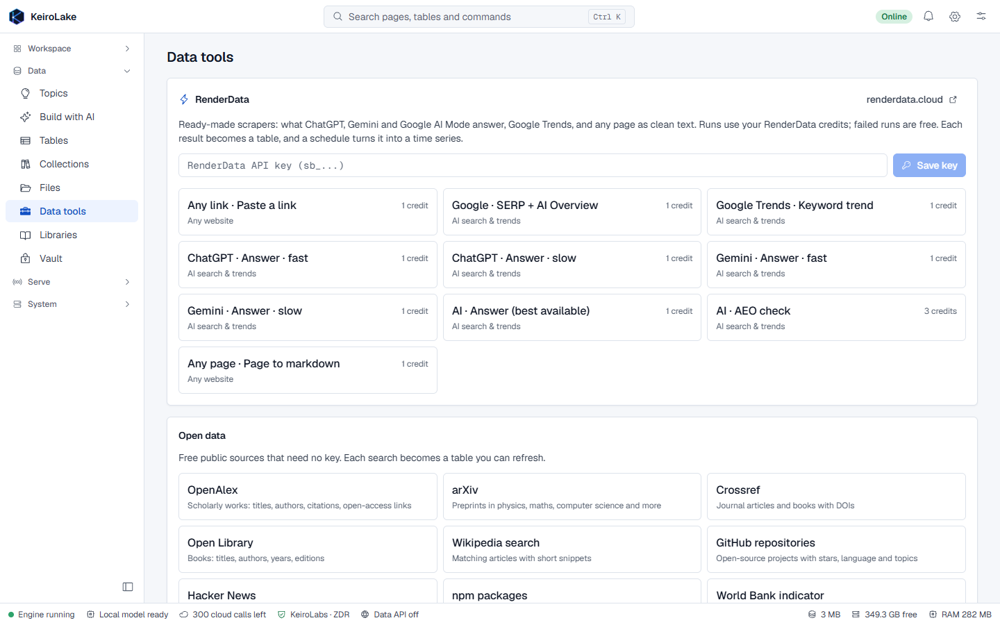

### Offline libraries and the map

Download Wikipedia (up to 119 GB with images), medical, repair and how-to guides from the Kiwix catalog, searchable
with no internet. The map draws your whole lake: sources, tables, collections, models and who can reach them.

|                                              |                                  |
| -------------------------------------------- | -------------------------------- |
| 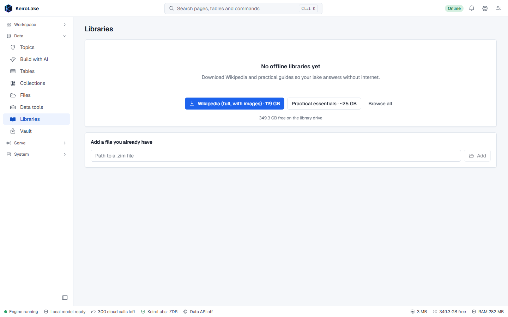 | 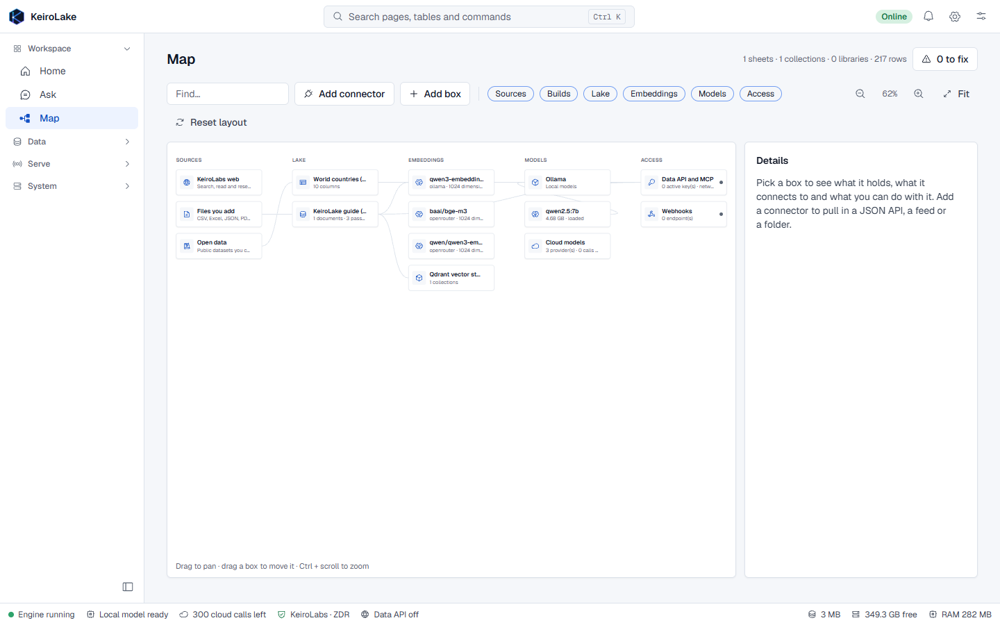 |

### Make it yours

Panels on Home you can show, hide and reorder; light, dark or system theme; five accent colours; text size, high
contrast and reduced motion; a command palette on `Ctrl K`.

## A data layer for your AI and apps

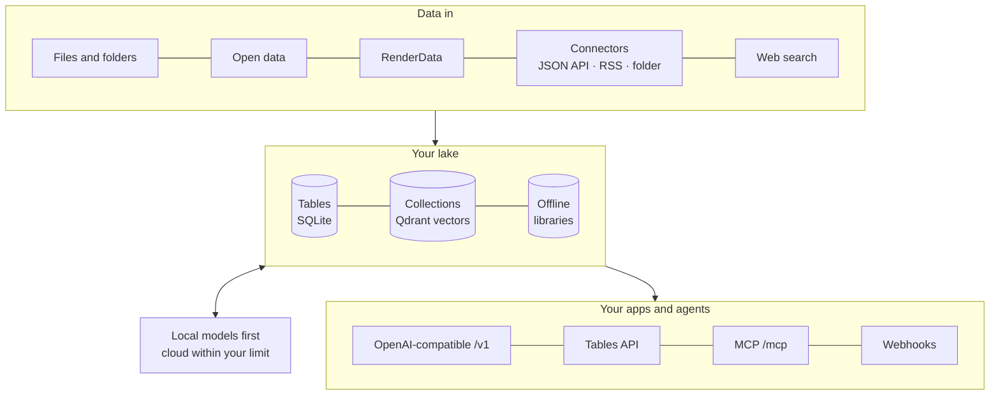

- **OpenAI-compatible endpoint:** any OpenAI SDK, LangChain, LlamaIndex or agent framework, by changing the base URL.
- **Tables as a database:** read, filter, sort, add and change rows over HTTP; search a table by meaning; saved views as JSON, CSV or JSON Lines.
- **MCP server:** 26 tools to search, ask, read and write tables, run read-only SQL, build a table by describing it,
  capture notes and links, build topics, and read markets, world events and threats. The tools a client sees depend on its key.
- **Claude, ChatGPT, Cursor and VS Code:** Serve → AI apps adds KeiroLake to Claude Desktop in one click, and gives a
  ready setup for the others ([how](docs/guide.md#use-it-from-claude-chatgpt-cursor-or-vs-code)).
- **Webhooks:** signed calls when imports finish or tables are created.

```bash
curl -H "Authorization: Bearer klk_..." "https://<address>/v1/tables/<id>/rows?where=region:eq:South%20Asia&order=-population&limit=10"
```

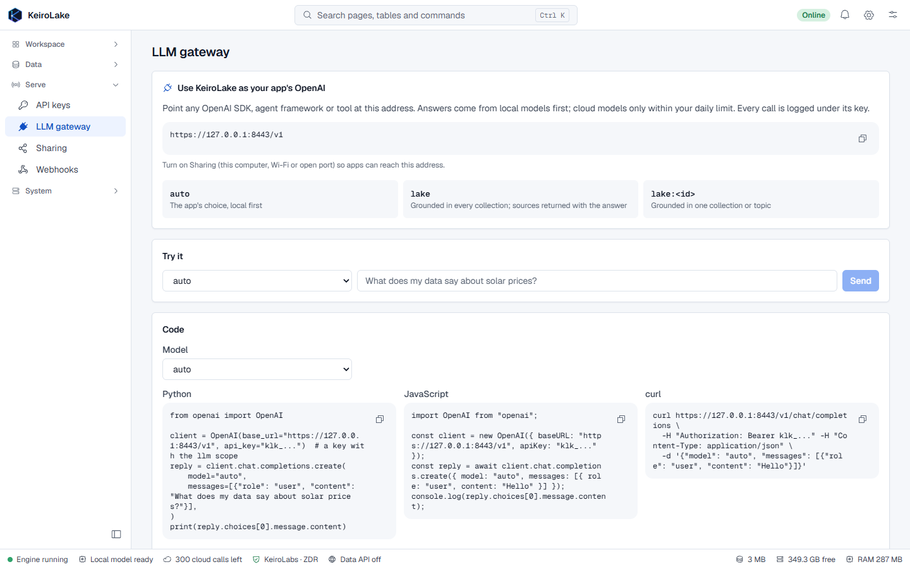

Full reference: [Use it from your own apps](docs/guide.md#use-it-from-your-own-apps).

## Reach it from anywhere

| Way in               | Who can reach it                        | Cost                                       |
| -------------------- | --------------------------------------- | ------------------------------------------ |
| **This computer**    | Only you                                | Free                                       |
| **Home Wi-Fi**       | Devices on your network, over HTTPS     | Free                                       |
| **Anywhere**         | Anyone with the private link            | Free, no account (Cloudflare quick tunnel) |
| **Your own address** | A fixed name like `lake.yourdomain.com` | Free on Cloudflare; you need a domain      |
| **Open port**        | The addresses you allow                 | Free; needs router access                  |

The internet link opens no ports: your computer connects out to Cloudflare. It comes back by itself after a restart.

**Keep it running while you're away:** a locked screen never pauses KeiroLake; **Keep this computer awake** stops
sleep while it runs; **Stay on with the lid closed** sets the lid action to "Do nothing" while plugged in and restores
your setting when turned off. A computer that is actually asleep or off can't answer: these options keep it from
falling asleep.

|                                          |                                                                |
| ---------------------------------------- | -------------------------------------------------------------- |
| 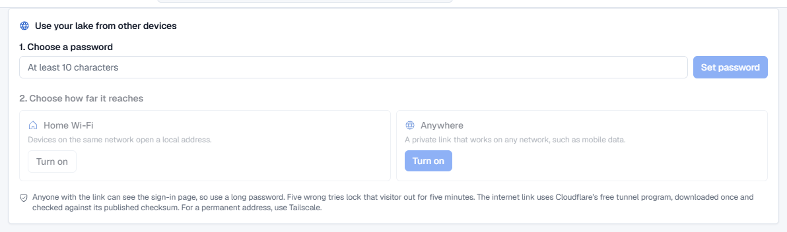 | 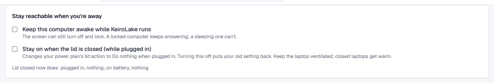 |

## Models: local, quantized and Heretic

- **Sized for your hardware:** KeiroLake reads your CPU, RAM, GPU and disk and recommends models that fit.
- **Quantized models:** pick a model from the Ollama library or a Hugging Face GGUF repo and a precision from Q2_K to
  F16. **Check** confirms the file exists and whether it fits your GPU or RAM before downloading. Re-quantize what
  you have, and tune context length, KV-cache precision, flash attention and keep-alive.
- **Heretic models:** point Models → Heretic at your [Heretic](https://github.com/p-e-w/heretic) folder, run it on a
  Hugging Face model (4-bit loading fits 0.6B–4B models in 8 GB of VRAM), then **Import as Q4_K_M**: converted to GGUF,
  quantized and added to Ollama. Heretic is AGPL-3.0 and not bundled; you're responsible for how you use a modified model.
- **Cloud when you want it:** OpenRouter, Groq, DeepSeek, Gemini, Anthropic, OpenAI, Mistral and Together, in the order you set.

|                                                            |                                                 |
| ---------------------------------------------------------- | ----------------------------------------------- |
| 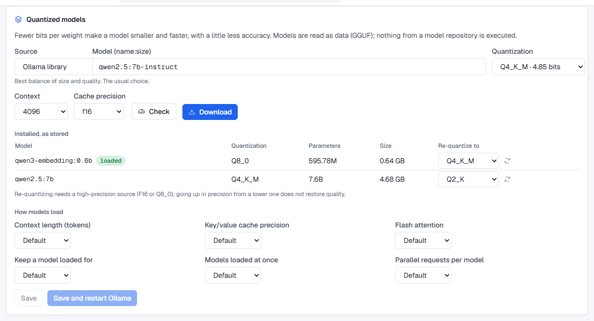 | 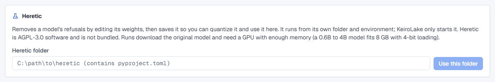 |

## Security

| You control                | How                                                                                                                                                                           |
| -------------------------- | ----------------------------------------------------------------------------------------------------------------------------------------------------------------------------- |
| **Where data lives**       | One folder on your machine. Back it up, copy it to a drive, or delete it.                                                                                                     |
| **What reaches the cloud** | Nothing until you add a cloud model or turn on web search; a daily cap on cloud calls; zero data retention asked of KeiroLabs on every request.                               |
| **Who gets in**            | Password (10+ characters) for every way in except this computer; five wrong tries lock a visitor out for five minutes; per-visitor rate limits; optional IP allow-list.       |
| **What apps can do**       | Keys with only the permissions you choose (`read`, `ask`, `write`, `sql`, `llm`), limited to certain collections, expiring, revocable, 120 calls a minute, every call logged. |
| **Private notes**          | The Vault: AES-256-GCM with a key from your passphrase (scrypt), locks after 15 idle minutes, only ever sent to local models.                                                 |
| **Updates**                | Signed with a key only the maintainer holds; checked before anything installs.                                                                                                |

The engine listens only on `127.0.0.1` with a new token every launch, so websites can't reach it. API keys are stored
as hashes, provider keys in the system keychain, SQL runs read-only, and downloaded models are data only (no pickles,
no repository scripts). Details in [SECURITY.md](SECURITY.md).

## Does it work on Windows, macOS and Linux?

| Platform                          | Status    | How it's tested                                                                                                      |
| --------------------------------- | --------- | -------------------------------------------------------------------------------------------------------------------- |
| Windows 10 / 11, x64              | Supported | Installed and exercised end to end: gateway, MCP, internet link, data tools, topics, packaged engine, 76 screenshots |
| Ubuntu 22.04+ / Debian 12+ (.deb) | Supported | Installed on a clean Ubuntu 22.04; engine, vector database and API checked; uninstalls cleanly                       |
| Any Linux (AppImage)              | Supported | Started on a clean Ubuntu 22.04 and checked the same way                                                             |
| Fedora / RHEL / openSUSE (.rpm)   | Built     | Package contents and dependencies checked; not yet installed on a Fedora machine                                     |
| Headless server / Docker          | Supported | `keirolake serve` and the container tested with sign-in, API keys and the CLI                                        |
| macOS 11+ (Apple Silicon)         | Built     | Built and engine-tested on GitHub's Mac machines every release; not yet tried on a real Mac by the maintainer        |
| ARM Linux, Windows on ARM         | Not yet   | Not built                                                                                                            |

Linux packages are built on Ubuntu 22.04 (glibc 2.35), so they install on most current distributions. Every release
runs these checks automatically before it's published.

## Updates and releases

**For users:** Settings → Updates checks GitHub Releases, downloads the new version, verifies its signature and
installs it (automatically if you choose). Windows, macOS and the AppImage replace themselves and restart; `.deb` and
`.rpm` installs go through your system's package manager and ask for your password. Servers see new versions with
`keirolake update`.

**For the maintainer:** every push to `main` runs [`release.yml`](.github/workflows/release.yml): engine tests and an
interface build, then the Windows installer, the Mac app (Apple Silicon) and the Linux packages are built,
each tested, signed for the updater and published as a release with `latest.json`. A failed Mac build is left out
instead of blocking the release. The version is the one in the repo, or one patch above the last
release. Bump minor or major with `python desktop/scripts/set_version.py 0.9.0`; skip a release with `[skip release]`
in the commit message. Notes come from [CHANGELOG.md](CHANGELOG.md).

## Build from source

```bash
cd backend && python -m venv .venv && .venv/bin/pip install -e ".[dev,desktop]"   # .venv/Scripts on Windows
.venv/bin/python -m pytest -m "not integration"
cd ../frontend && npm ci && npm run dev            # interface on :5173 (engine: python qa/dev_engine.py)
cd ../desktop && npm ci && python scripts/launch.py # the desktop app (Rust and Tauri prerequisites needed)
bash desktop/scripts/ci_linux.sh                    # Linux packages in Docker, tested on a clean system
```

## Documentation

| Read                                 | For                                                          |
| ------------------------------------ | ------------------------------------------------------------ |
| [User guide](docs/guide.md)          | Every page and setting, step by step                         |
| [Architecture](docs/architecture.md) | How data flows through the lake, search, answers and sharing |
| [Providers](docs/providers.md)       | Cloud and local models and embeddings                        |
| [Pipelines](docs/pipelines.md)       | Collecting web data on a schedule                            |
| [Security](SECURITY.md)              | Reporting a problem, and how data is protected               |
| [Changelog](CHANGELOG.md)            | What changed in each version                                 |
| [Contributing](CONTRIBUTING.md)      | Ideas, bug reports and code changes                          |

## Contributing and contact

KeiroLake is made by **Roushan** ([@KumarRoushan9234](https://github.com/KumarRoushan9234)).

- **Ideas, bugs or feature requests:** email **roushan9234620012@gmail.com** or open an issue.
- **Want to push a change yourself?** Email first with what you'd like to change, so we can agree on it before you
  start. Then fork, make a focused change, and open a pull request. See [CONTRIBUTING.md](CONTRIBUTING.md).
- **Security problems:** email only, please. See [SECURITY.md](SECURITY.md).

## License

[MIT](LICENSE). Uses [Qdrant](https://qdrant.tech) (Apache-2.0), [Tauri](https://tauri.app), and
[Ollama](https://ollama.com) for local models. Offline libraries come from [Kiwix](https://kiwix.org) under their own
licenses. [Heretic](https://github.com/p-e-w/heretic) (AGPL-3.0) is not included.
