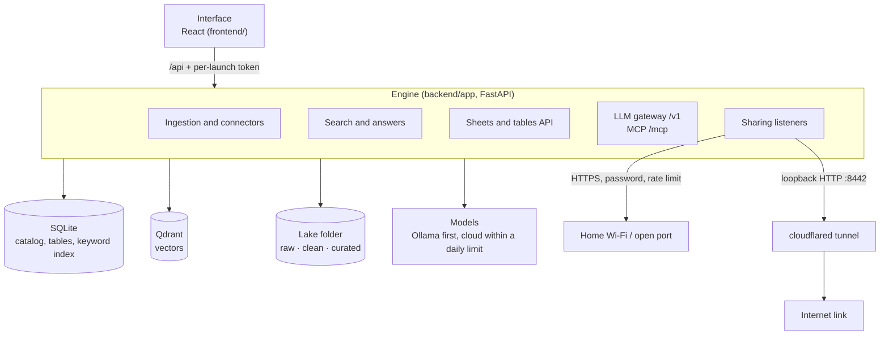

# Architecture

How KeiroLake is put together, for people who want to understand it or change it. To use the app, read the
[user guide](guide.md) instead.

## Overview

| Part | Code | Notes |
|---|---|---|
| Engine | `backend/app/main.py` | One FastAPI app. In the desktop app it runs on a random `127.0.0.1` port with a per-launch token. |
| Ingestion | `app/ingest/`, `app/connectors.py`, `app/watch.py` | Files, web pages, connectors and watched folders all land in `raw/` first. |
| Search and answers | `app/rag/`, `app/embeddings/`, `app/vector/` | Hybrid search: vectors in Qdrant plus SQLite FTS5, fused by rank. |
| Tables | `app/sheets/`, `app/tables_api.py`, `app/lake/warehouse.py` | Every table is a SQLite table with history and cell-level sources. |
| Build with AI | `app/builder.py` | Chat to agree a schema, then fill rows in batches with sources and confidence. |
| Models | `app/llm/`, `app/local/` | Provider fallback chain; Ollama management, quantization and the Heretic runner. |
| Your apps | `app/api/gateway_routes.py`, `app/api/public_routes.py`, `app/access.py` | OpenAI-compatible `/v1`, tables API and MCP behind scoped, hashed, logged keys. |
| Sharing | `app/network.py`, `app/tunnel.py`, `app/auth.py`, `app/power.py` | Listeners, the Cloudflare tunnel, sign-in and lockout, keep-awake and lid settings. |

### Sharing listeners

The desktop window talks to the engine directly. Other devices never do: they reach **listeners** that serve the web
app (after sign-in), `/v1` and `/mcp` (with a key), and refuse the management API.

- **This computer** and **Home Wi-Fi / open port** share one listener: plain HTTP on loopback, or HTTPS on all
  interfaces with a certificate made on the PC (or your own), with an optional IP allow-list.
- **The internet link** has its own loopback-only HTTP listener (port 8442). `cloudflared` connects out to Cloudflare
  and forwards visitors to it, so switching Wi-Fi sharing on or off never breaks the link. A quick tunnel uses
  `--url`; your own address uses `tunnel run` with the token passed in the environment, never on the command line.
- Every listener applies the same rules: sessions, a 10-character password minimum, five-try lockout, per-visitor rate
  limits and the allow-list.
- The tunnel's on/off state is remembered and restored at start-up. Stray `cloudflared` processes from a crashed run are
  stopped first.

### Power

`app/power.py` keeps the computer awake with `SetThreadExecutionState` on Windows (held by a dedicated thread) and
`systemd-inhibit --what=sleep:idle` on Linux. The lid option reads the current power plan with `powercfg /qh` (many
laptops hide the lid setting from `/q`), saves it, sets "Do nothing", and restores the saved values when turned off.

### Background work

Nothing long-running belongs to a page.

- **Engine jobs** (`app/jobs/runner.py`): one writer lane for ingestion and a background lane with four workers for
  downloads, model pulls, indexing and Build-with-AI steps. Job state is in SQLite, so the UI can poll it and some
  jobs resume after a restart.
- **Build-with-AI sessions** (`app/builder_sessions.py`): the conversation, the editable draft, options and what was
  built live in `<data>/builder/<id>.json`. A message or a fill is a job that writes its result into the session, so
  the reply lands whether or not a page is open. At start-up, a step cut off by a restart is marked as such.
- **The interface's background store** (`frontend/src/background.ts`): requests started from a page run outside
  React, so unmounting a page doesn't drop them; their results are kept per session. One shared poller watches the
  job list for every page, and announces jobs and tasks that finish while you're elsewhere.

### Updates and releases

- **Desktop:** `tauri-plugin-updater` reads `releases/latest/download/latest.json` on GitHub, verifies the download
  against the public key in `tauri.conf.json`, stops the engine and Qdrant (their files are replaced) and installs.
  The NSIS installer updates Windows, the `.app.tar.gz` updates macOS and the AppImage updates itself; `.deb`/`.rpm`
  copies update through the engine (see below).
- **Everyone else:** `GET /api/updates` (`app/updates.py`) reads the GitHub Releases API, cached for six hours.
- **Publishing:** `.github/workflows/release.yml` runs on every push to `main`. It picks the version
  (`desktop/scripts/set_version.py --next`), runs the engine tests and interface build, builds the Windows installer,
  the Mac app (Apple Silicon, ad-hoc signed, engine-tested on the runner) and the Linux packages (on
  Ubuntu 22.04 in Docker, each installed and started on a clean system, with a hard time limit), signs the
  updater files with `TAURI_SIGNING_PRIVATE_KEY`, writes `latest.json` and `SHA256SUMS`, and publishes the release with
  notes from `CHANGELOG.md`.

### Capture and speech

- `app/inbox.py` takes captures (voice, photo, link, text, shared files) as background jobs into a "Captured" collection,
  made on first use. Raw recordings and photos are kept in the lake's `raw/` zone like any other input.
- `app/speech.py` runs faster-whisper on this computer. Audio is decoded to 16 kHz mono with PyAV in the engine itself
  (not faster-whisper's helper, which breaks across PyAV versions). The CTranslate2 model downloads once into
  `<data>/models/whisper`.
- Photos are read by a local Ollama vision model, chosen by its `vision` capability. Models with a `remote_host`
  (Ollama's cloud models) are skipped, so photos never leave the machine.
- In the browser, `frontend/src/capture.ts` sends captures, or keeps them in IndexedDB (`keirolake` → `queue`) while
  the lake is unreachable. The service worker writes items from the Android share sheet (`/share-target`) into the
  same queue.

### Package updates on Linux

Tauri's updater can't replace `.deb`/`.rpm` installs. For those, `app/updates.py` downloads the package from the
release, checks it with `app/minisign.py`, an Ed25519 check of the same minisign signature format and key the Tauri
updater uses, and installs it with `pkexec apt-get`/`dnf`, so the system asks for the password. The shell's `relaunch`
command restarts the app afterwards.

### Headless

`keirolake serve` (`app/serve.py`) runs the same engine with no window. It picks a free loopback port and a random
token for the engine (written to `<data>/serve.json`, readable only by the user, which the CLI uses), saves the sharing
mode and password, and starts the sharing listener. The Docker image runs exactly this.

## Data lake zones

| Zone | Contents | Written by |
|---|---|---|
| `raw/<kind>/<date>/<run_id>/` | Exactly what came in: uploaded files, KeiroLabs JSON responses. Never modified. | ingestion |
| `clean/<kb>/` | One normalized Markdown file per document | ingestion pipeline |
| `curated/` | CSV export of every curated warehouse table | `Save as table` |

Lineage is stored in SQLite: `chunk → document → ingestion_run → source`, with the raw and clean file paths on the document. `GET /api/lineage/chunks/{id}` returns the whole chain.

## Ingestion pipeline

1. Land the input in `raw/` and register a `source` and an `ingestion_run`.
2. Parse to text (PDF, DOCX, HTML, Markdown, text, JSON). Web inputs arrive as Markdown from KeiroLabs.
3. Skip the document if the same content hash already exists in the knowledge base.
4. Write the clean file, split into chunks (default 1500 characters, 200 overlap, so every embedding model in the default chain accepts them).
5. Embed the chunks through the embedding chain.
6. Upsert points into Qdrant (payload carries the chunk text and ids needed to cite) and insert chunk rows into SQLite. An FTS5 index follows by trigger.

Chunk ids are deterministic UUIDs, so re-running ingestion cannot create duplicate points.

## Embedding fallback without mixing vector spaces

Vectors from different models are not comparable, even at the same dimension. So:

- Each collection has **one named vector per model** in `EMBED_MODELS`.
- At ingest, a batch is embedded entirely by the first healthy model. On failure the chain retries (429/5xx, exponential backoff), then moves to the next model and opens a 2-minute circuit breaker on the failing one. The point stores only that model's vector plus `embed_model` in its payload.
- At query time, the question is embedded with **every model that has points** in the knowledge base. Each runs its own Qdrant search, and the result lists are fused with the SQLite keyword results by Reciprocal Rank Fusion (k=60).
- If a model is down at query time, the others still answer and the UI reports a warning.
- **Re-embed** builds a new collection version from the chunk text stored in SQLite, then flips the alias, so searches never see a half-built index.

Per-model prompts matter and are handled in `embeddings/providers.py` (`query:` / `passage:` for E5, the retrieval instruction for BGE-large-en and Qwen3). Models that support Matryoshka truncation receive the `dimensions` parameter so they match the configured size.

If `EMBED_MODELS` changes after a knowledge base exists, new models need a **Re-embed** before they can be used for that knowledge base. Ingestion refuses to write vectors Qdrant has no slot for and says so.

## LLM routing

For each provider in `LLM_FALLBACK_ORDER`, each model in `<PROVIDER>_MODELS` is one attempt. 429/5xx/timeouts/unknown-model errors move to the next attempt, and a failed model sits out for 60 seconds. For streaming, fallback happens before the first token. The response records which model answered.

## Warehouse

- Uploaded tables are `ds_<name>`, curated tables `cur_<name>`. Column names are normalized to `snake_case`.
- Queries run on a connection opened with `mode=ro` and `PRAGMA query_only=ON`, after a SELECT-only check. Writes happen only through `CREATE TABLE ... AS SELECT` on the curated path.
- "Generate SQL" prompts the LLM with the schema and sample rows, validates the result, runs it read-only and retries once with the error message.
- SQLite runs in WAL mode; all ingestion jobs go through a single in-process worker, so there is one writer at a time.

## RAG answers

Retrieval returns the top chunks. If the best cosine similarity is below `RAG_WEB_THRESHOLD` (or you pick *Web: always*), KeiroLabs is searched and its results are added as `[W1]`, `[W2]` sources next to the local `[1]`, `[2]`. The prompt tells the model to cite every claim and to say when the sources don't answer the question.

## KeiroLabs endpoints used

Checked against the live API with a search-lite key:

| Use | Endpoint | Notes |
|---|---|---|
| Search preview, feeds | `POST /api/v2/search/lite` | Titles, URLs, snippets; fractions of a credit |
| Richer snippets | `POST /api/v2/search/fast` | |
| Web search with page content | `POST /api/v2/search/content` | Used for web ingestion |
| Known URLs | `POST /api/v2/extract` | Clean Markdown |
| Research dossiers | `POST /api/v2/deep` | Answer-ranked pages crawled in full, evidence passages and a confidence score; 15-50 s, 2 credits |
| Whole websites | `POST /api/v2/sitemap` | Every URL a site publishes with `lastmod`; the newest pages are then fetched with `extract` |

A **research** ingest stores one dossier document (evidence first, then sources ranked by answer likelihood, each with its excerpt) plus the top pages in full, all under one ingestion run. **Followed searches** (feeds) re-run a search on an interval, or on demand with *Run now*, and content hashing makes repeat runs idempotent.

`search/lite` rejects `content: true` ("SERP-only"), so ingestion uses `search/content` for full pages and `lite`/`fast` for snippet-only feeds. The client reports out-of-credits (402) and forbidden (403) clearly and tracks `creditsRemaining`.
