# KeiroLake user guide

How each part of KeiroLake works, with the details the [README](../README.md) leaves out.

- [Getting started](#getting-started)
- [Home](#home)
- [Ask](#ask)
- [Build with AI](#build-with-ai) and [background work](#background-work)
- [Tables](#tables)
- [Topics](#topics)
- [Collections and files](#collections-and-files)
- [Data tools](#data-tools)
- [Connectors and watched folders](#connectors-and-watched-folders)
- [Offline libraries](#offline-libraries)
- [Map](#map)
- [Models](#models): [quantized](#quantized-models) and [Heretic](#heretic-models)
- [Sharing](#sharing): [over the internet](#over-the-internet), [your own address](#your-own-address),
  [stay reachable](#stay-reachable-when-youre-away)
- [Use it from Claude, ChatGPT, Cursor or VS Code](#use-it-from-claude-chatgpt-cursor-or-vs-code)
- [Use it from your own apps](#use-it-from-your-own-apps)
- [Backups](#backups)
- [Updates](#updates)
- [Other ways to run it](#other-ways-to-run-it): [headless server](#headless-server), [Docker](#docker), [phone app](#as-an-app-on-your-phone-or-another-computer), [Capture](#capture-from-your-phone), [command line](#command-line)
- [Keyboard and display](#keyboard-and-display)
- [Docs and logs](#docs-and-logs)
- [Troubleshooting](#troubleshooting)

## Getting started

1. [Download KeiroLake](https://github.com/KumarRoushan9234/Keirolake/releases/latest) and install it.
2. Install [Ollama](https://ollama.com/download) for local AI models.
3. Open KeiroLake. The setup screen offers **Set up everything for me**: it installs the recommended model and an offline
   library, shows the total size first, and resumes if a download is interrupted.

A fresh install includes sample data: a **World countries** table (World Bank, CC BY 4.0) with a saved view, and a short
**KeiroLake guide** collection you can ask questions about. Remove them any time from Settings.

Your data lives in one folder:

| System | Folder |
|---|---|
| Windows | `%APPDATA%\app.keirolake.desktop` |
| macOS | `~/Library/Application Support/app.keirolake.desktop` |
| Linux | `~/.local/share/app.keirolake.desktop` |

**On a Mac:** open the `.dmg` and drag KeiroLake to Applications. The app isn't notarized by Apple yet, so the first
time, right-click it and choose **Open**. If macOS says it "is damaged", run `xattr -cr /Applications/KeiroLake.app`
in Terminal (it clears the download quarantine flag), then open it again. Install the Ollama app for Mac for local
models.

## Home

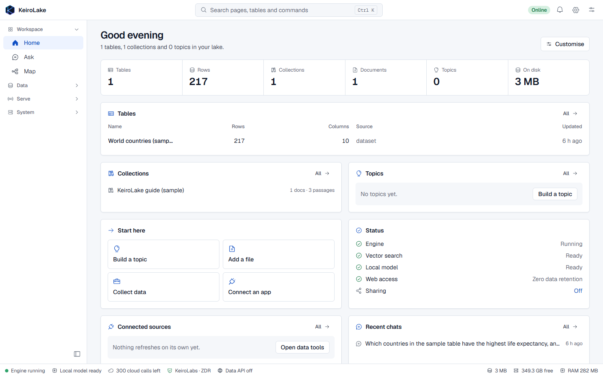

What is in your lake at a glance: tables, rows, collections, documents, topics and disk use, with your latest tables,
collections, topics and chats. **Customise** shows, hides and reorders the panels.

## Ask

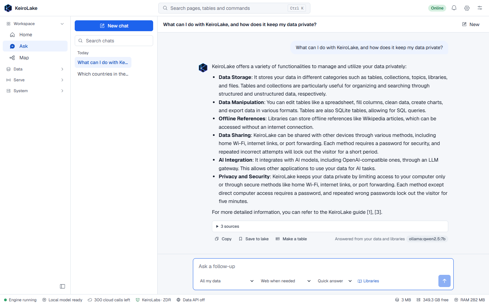

Ask anything about your data in plain language. Under the message box:

- **What to search:** all your data, or one collection or topic.
- **Web:** never, only when your data can't answer, or always (KeiroLabs search with zero data retention).
- **Depth:** a quick answer, or a deeper one that reads more passages.
- **Libraries:** include your offline libraries.

Each answer shows its numbered sources (`[1]` from your data, `[Z1]` from offline libraries, `[W1]` from the web) and
which model wrote it. **Save to lake** keeps an answer as a document. **Make a table** turns it into a sheet. Chats are
saved, grouped by day, and can be searched and renamed. A chat keeps running if you switch pages.

## Build with AI

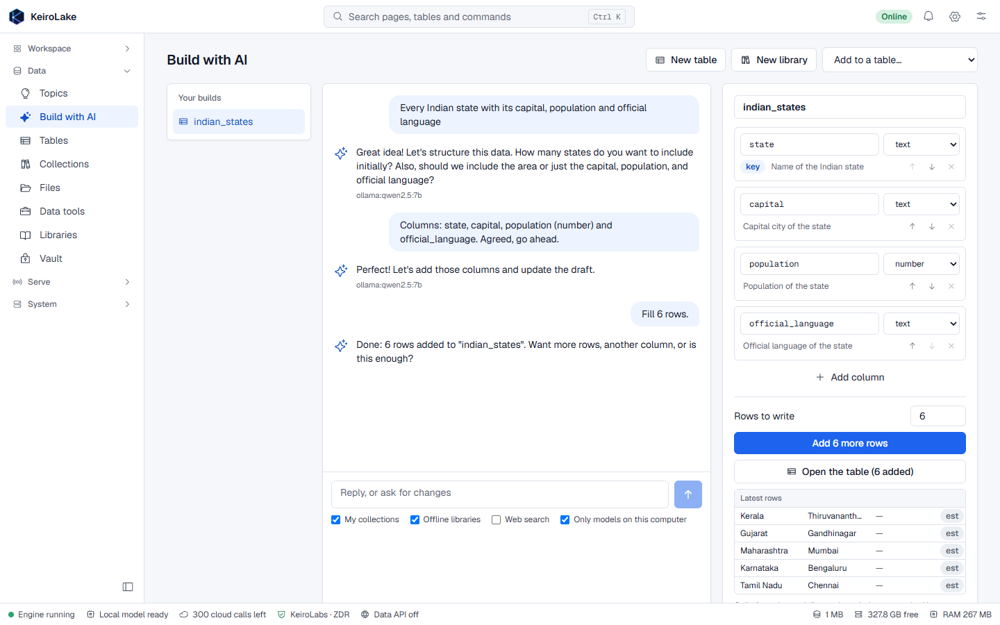

Make a table or a small offline library by talking it through.

1. Press **New table** or **New library**. Pick a starter idea or describe what you want.
2. The AI suggests a name and columns (or sections). The plan appears on the right; the first column is the **key**
   that tells rows apart.
3. Shape it in the chat ("add a column for the official language", "make it 50 rows") or edit the plan directly:
   rename a column, change its type, move it up or down, remove it, or add one. Sections work the same way.
4. Press **Create and fill**. Rows are written in batches of ten, and no key is repeated.
5. When it's done it asks what's next: **Add more rows**, agree another column (added to the same table), or write
   more sections. **Latest rows** shows what was just written, with **src** (from a source) or **est** (the model's
   estimate) on each row.

To extend a table you already have, choose it in **Add to a table…**: the conversation starts from its columns.

Sources, under the message box:

| Option | What the AI reads before writing |
|---|---|
| My collections | Matching passages from your documents |
| Offline libraries | Matching articles from Wikipedia and your other libraries |
| Web search | Pages found through KeiroLabs (needs a key; zero data retention) |
| Only models on this computer | Not a source: keeps every model call on your machine |

Each cell records where it came from. Cells written from the model's own knowledge are marked "model knowledge" with
low confidence: small local models get numbers and lists wrong, so check anything important, or turn on a source.

**It keeps working when you leave.** Every build is saved in **Your builds** on the left. Send a message or start a
fill, go anywhere in the app (or close the window), and the reply or the rows are there when you come back. A notice
appears when it's done. After a restart the conversation is still there; a step that was cut off says so and can be
sent again.

From the command line: `keirolake build "Indian states with capital and population" --rows 30` plans and fills a
table in one go.

## Background work

Long tasks don't stop when you switch pages:

- **Engine jobs** (imports, downloads, fills, indexing, model pulls) run in the engine itself.
- **Requests started from a page** (asking a sheet, planning a table from a description, reading web pages into a
  table, cleaning, the gateway's Try it) run in the app's background store. Come back to the page for the result.

A notice appears in the corner when something finishes while you're elsewhere, with **Open** to go straight to the
result. The bell in the top bar counts everything running and lists recent jobs; **Open Jobs** has the full history
with logs.

## Tables

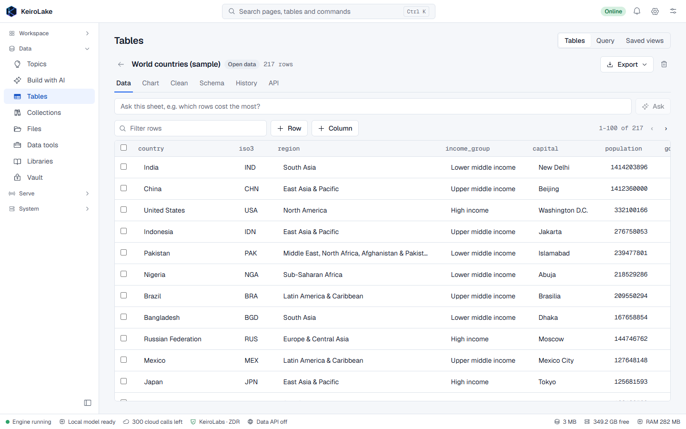

Every table is a sheet.

- **Data:** edit cells, add rows and columns, filter, select and delete. Ask the sheet a question in plain language.
- **Chart:** chart any column, computed over all rows.
- **Clean:** suggested fixes for types, spacing and duplicates, applied when you agree.
- **Schema:** column names, types and descriptions.
- **Build:** add rows and columns from the web or the local model.
- **History:** every change to the table.
- **API:** ready-made code to read this table from your apps.

**Import** CSV, Excel or JSON, or a table from a PDF. **Export** to CSV, Excel, JSON or PDF.
**Query** runs read-only SQL over all your tables. **Saved views** keep a query under a name your apps can read.

## Topics

Name a subject ("solar panel prices in India") and KeiroLake finds pages about it, builds a cleaned sheet where every row
links to its page, keeps the page text searchable, and saves a CSV in your lake folder. Needs a KeiroLabs key for web search.

## Collections and files

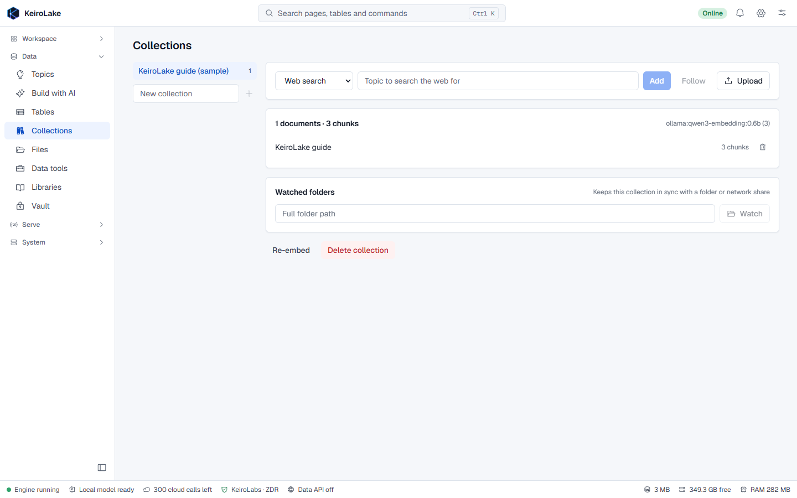

A collection holds documents (PDF, Word, Markdown, text, web pages), split into passages and searchable by meaning and
by keyword. **Files** shows the original files in your lake: untouched originals in `raw/`, cleaned text in `clean/` and
finished tables in `curated/`.

The **Vault** keeps private notes encrypted with a passphrase that only you know.

## Data tools

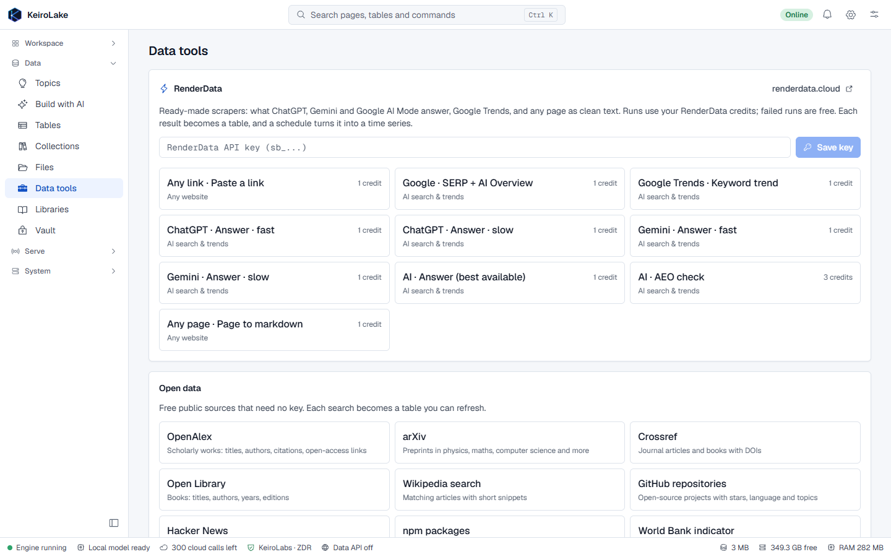

**Open data:** free public sources that need no key. Search, and the results become a table you can refresh:
OpenAlex (research papers), arXiv, Crossref, Open Library, Wikipedia search, GitHub repositories, Hacker News, npm
packages, World Bank indicators and OpenStreetMap places.

**RenderData:** ready-made scrapers from [renderdata.cloud](https://renderdata.cloud), using your own key and credits
(failed runs are free):

- what ChatGPT, Gemini and Google AI Mode answer to a question, and AEO checks;
- Google search results and Google Trends;
- any page as clean text: paste a link.

The scraper list comes live from RenderData, so new scrapers appear by themselves. Schedule a run and turn on **keep
every run** to build a time series (for example, how an AI's answer about your brand changes week to week).

## Connectors and watched folders

Keep data flowing in without doing it by hand.

**Connectors** (Map → **Add connector**) fill a table and refresh it on a schedule:

| Kind | Give it | Becomes |
|---|---|---|
| JSON API | A public address, and where the list of records is (for example `data.items`) | One row per record |
| RSS / Atom feed | The feed address | One row per item |
| Folder | A folder on this computer | Rows from every CSV, Excel and JSON file in it |
| RenderData | A scraper and its inputs | One row per result, optionally kept as a time series |

Pick a **key column** and repeated runs update matching rows instead of adding duplicates. Without one, the table is
replaced and the old version stays in its history. Addresses must be public: connectors never reach into your home
network.

**Watched folders** keep a collection in sync with a folder: new and changed files are indexed, deleted ones removed.

## Offline libraries

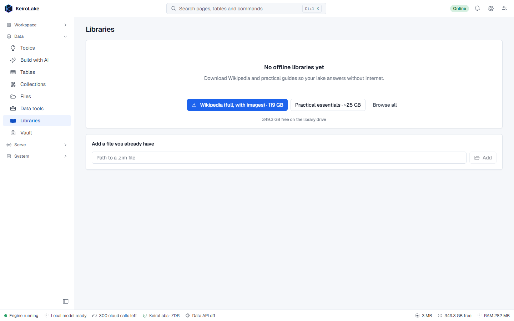

Download libraries from the Kiwix catalog, such as Wikipedia (from a few GB to 119 GB with images), medical guides, repair
and how-to guides, and dictionaries. Each download is checked when it finishes. A library can be searched by article
title right away. Index the article intros, or every passage, to search it by meaning. The **Reader** opens library pages
offline and web pages online, and **Save** puts any page into your lake.

## Map

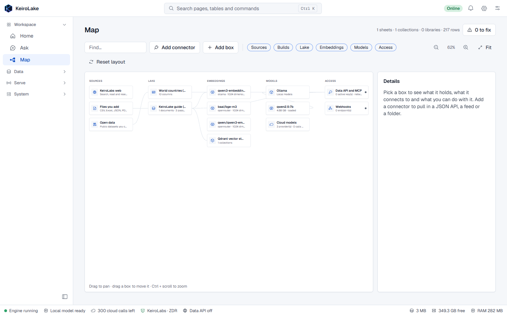

Your lake drawn as a graph, from left to right: sources, the lake, embeddings, models and access. Click a box to see what
it holds and what you can do with it. **To fix** lists anything broken, such as a missing model or a collection that
needs re-indexing. **Add connector** pulls in a JSON API, a feed or a folder on a schedule.

## Models

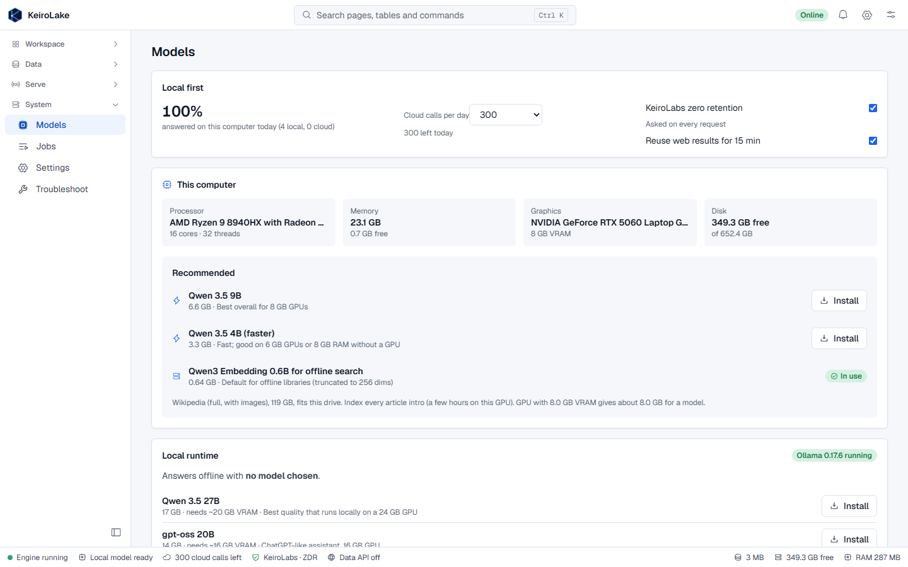

- **Local first:** how many answers today came from this computer, the daily limit on cloud calls, and zero data
  retention for web search.
- **This computer:** your processor, memory, graphics card and disk, and the models recommended for them. One click
  installs a recommendation.
- **Local runtime:** the models installed in Ollama, and which one answers by default.
- **Cloud models:** OpenRouter, Groq, DeepSeek, Gemini, Anthropic, OpenAI, Mistral and Together, tried in the order you
  set, and used only up to the daily limit.

### Quantized models

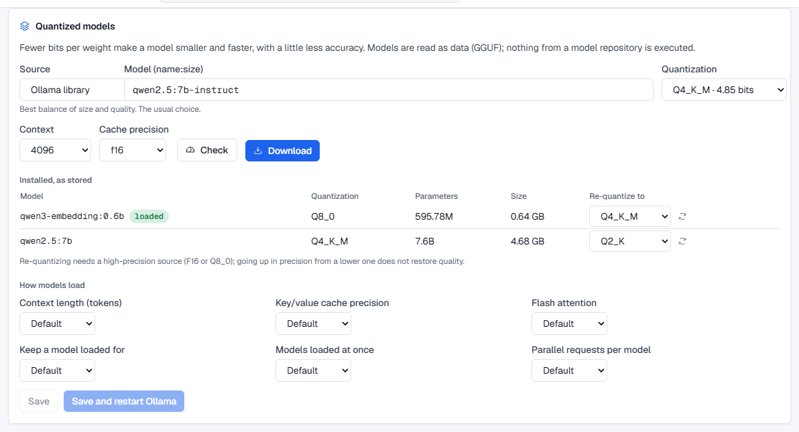

A quantized model keeps fewer bits per weight: smaller and faster, slightly less accurate.

| Precision | Bits per weight | Use it when |
|---|---|---|
| Q2_K | ~3.0 | Memory is very tight; quality drops noticeably |
| Q3_K_M | ~3.9 | Small memory, some quality loss |
| Q4_K_M | ~4.9 | **The usual choice:** best balance of size and quality |
| Q5_K_M | ~5.7 | Closer to the original |
| Q6_K | ~6.6 | Very close to the original |
| Q8_0 | ~8.5 | Nearly lossless, half the size of F16 |
| F16 | 16 | Full precision; the source for re-quantizing |

To get one:

1. **Source:** the Ollama library (`name:size`, for example `qwen2.5:7b`) or a Hugging Face repository with GGUF files
   (`owner/name`).
2. **Quantization**, **Context** and **Cache precision:** a longer context and a higher-precision cache use more memory.
3. **Check:** confirms that exact file exists, estimates the memory it needs (weights plus cache), and says whether it
   fits your graphics card, your RAM, or neither.
4. **Download:** the model appears in the installed list and can be used everywhere.

**Re-quantize** an installed model to a smaller precision from the list. Start from F16 or Q8_0: going up from a lower
precision doesn't bring quality back. **How models load** sets the context length, cache precision, flash attention, how
long a model stays loaded, how many load at once, and parallel requests. **Save and restart Ollama** applies them.

Only model weights (GGUF and safetensors) are downloaded: never pickle files or scripts from a model repository.

### Heretic models

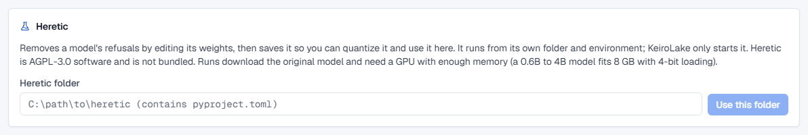

[Heretic](https://github.com/p-e-w/heretic) changes a model's weights to remove its built-in refusals. KeiroLake can
run it and bring the result into Ollama.

1. **Get Heretic.** Download it yourself (it's AGPL-3.0 and not bundled), then paste its folder (the one with
   `pyproject.toml`) and press **Use this folder**.
2. **Set up Heretic.** KeiroLake makes a private Python environment for it with PyTorch, using CUDA when it finds an
   NVIDIA GPU. This takes a few minutes and a few GB the first time.
3. **Run.**
   - **Model:** a Hugging Face id (`owner/name`) or a folder on your computer.
   - **Preset:** one of the configurations in your Heretic folder.
   - **Trials:** more trials search longer for a better result (30 to 50 is a good start).
   - **Load in 4-bit while working:** saves memory. A 0.6B to 4B model fits an 8 GB graphics card this way.
   - **Save as:** a full model (needed for import) or only a LoRA adapter.

   Your loaded Ollama models are unloaded first to free the graphics card. Progress and the live log show in the app.
4. **Import.** On a finished run, type a name (for example `qwen3-4b-heretic`) and press **Import as Q4_K_M**. The first
   import downloads llama.cpp's converter (about 39 MB). Then KeiroLake converts the run to GGUF, quantizes it to
   Q4_K_M and adds it to Ollama.
5. **Use it.** Pick it in Ask, Build with AI or the API like any other local model.

You are responsible for how you use a modified model.

## Sharing

Under **Serve → Sharing**. Choose a password first (at least 10 characters): every way in except this computer needs it.

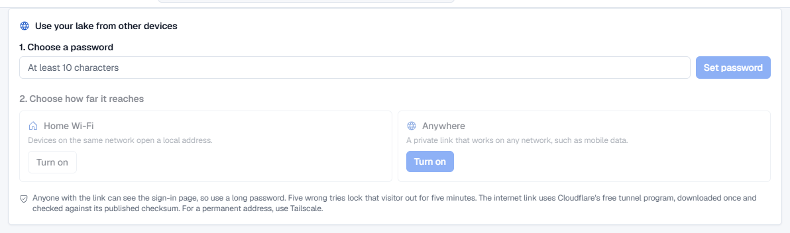

| Way in | Who can reach it | Notes |
|---|---|---|
| This computer | Only you | Always on. |
| Home Wi-Fi | Devices on your network | HTTPS with a certificate made on your computer (the browser warns once). |
| Anywhere | Anyone with the link | Cloudflare's free quick tunnel, no account needed. A new random name each start; it comes back by itself after a restart. |
| Your own address | Anyone with the address | Your own Cloudflare tunnel with a fixed name like `lake.yourdomain.com`. Free, but needs a domain on Cloudflare. |
| Open port | Who you allow | Your own port, HTTPS certificate, IP allow-list, optional router forwarding and an outside reachability check. |

### Over the internet

1. Set a password, then press **Turn on** under **Anywhere**. The first time, KeiroLake downloads Cloudflare's tunnel
   program and checks it against its published checksum.
2. Copy the link it shows (`https://some-random-words.trycloudflare.com`) and open it on any device. Sign in with your
   password to use the app.
3. Your apps and AI tools use the same link with an API key: `<link>/v1` for the API and `<link>/mcp` for MCP.

How it works: your computer opens an outgoing connection to Cloudflare, and visitors reach the app through it. Nothing
changes on your router and no port is opened. The link stays on until you turn it off, and comes back by itself after
the app restarts. A brand-new link can take up to a minute before every network can find it.

Check it from another device:

```bash
curl -H "Authorization: Bearer klk_..." https://<your-link>/v1/me
```

A reply with your key's name means the API works over the internet. Without a key, the reply is `401`.

The free quick tunnel is a Cloudflare service for testing and personal use, with no uptime promise, and the name
changes every time it starts. For a name that never changes, use your own address.

### Your own address

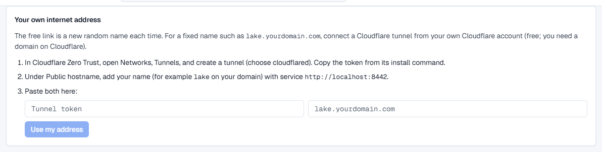

1. In Cloudflare Zero Trust, open **Networks → Tunnels** and create a tunnel (choose cloudflared).
2. Under **Public hostname**, add your name (for example `lake` on your domain) with the service `http://localhost:8442`.
3. Copy the token from the install command, paste it and your hostname into **Your own internet address**, and press
   **Use my address**.

The token is kept with your other secrets in the system keychain. **Go back to the free random link** switches back.

### Stay reachable when you're away

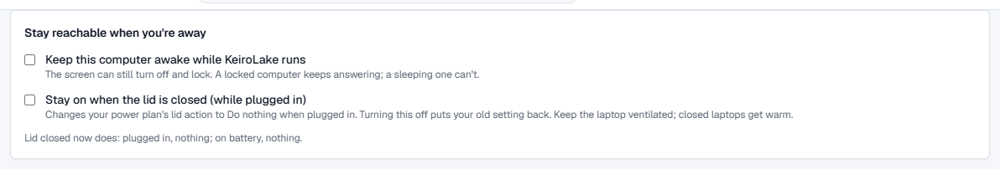

| Situation | Does KeiroLake keep answering? |
|---|---|
| Screen locked or turned off | Yes, always. |
| You walk away and the computer would normally fall asleep | Yes, with **Keep this computer awake** on. |
| Laptop lid closed | Yes, with **Stay on when the lid is closed** on and the laptop plugged in. |
| Computer asleep, hibernating or shut down | No. Nothing can answer from a sleeping computer. |

- **Keep this computer awake** asks Windows (or Linux) not to sleep while KeiroLake runs. It's released when you turn it
  off or close the app.
- **Stay on when the lid is closed** changes your power plan's lid action to "Do nothing" while plugged in, and on
  battery too if you choose. The panel shows what the lid does now. Turning it off puts your old setting back.
  On Linux, set `HandleLidSwitch=ignore` (and `HandleLidSwitchExternalPower=ignore`) in `/etc/systemd/logind.conf`,
  then restart `systemd-logind`.
- Keep a closed laptop somewhere it can breathe: it gets warm.

## Use it from Claude, ChatGPT, Cursor or VS Code

**Serve → AI apps** connects an AI app to your lake through MCP. Pick the app and what it may do (`read`, `ask`,
`write`, `llm`, `sql`); each app gets its own key, so you can revoke one without touching the others.

| App | How it connects |
|---|---|
| **Claude Desktop** | Click **Add to Claude Desktop**, then quit Claude Desktop (also from the tray) and open it again. KeiroLake adds itself to Claude's config and keeps a backup of the old one next to it. |
| **Claude Code** | Run the `claude mcp add …` command shown. |
| **Cursor**, **VS Code** | Paste the JSON shown into `~/.cursor/mcp.json` or `.vscode/mcp.json`. |
| **Claude.ai**, **ChatGPT** | Turn on the [internet link](#over-the-internet) first. Then in Claude.ai: *Settings → Connectors → Add custom connector*; in ChatGPT: *Settings → Apps & Connectors → Advanced → Developer mode → Create*, with *No authentication*. Paste the connector link shown. |

Claude Desktop, Claude Code, Cursor and VS Code start KeiroLake's own MCP bridge (`keirolake-desktop mcp`) on this
computer. It finds the running app by itself and starts it in the tray if it isn't running, so nothing needs to be open
to the network. The connector link for Claude.ai and ChatGPT carries the key inside it: treat it like a password, and
revoke the key under **API keys** to cut access. KeiroLake never writes that key to its logs.

What an AI app can do, depending on its permissions:

| Tool | Does |
|---|---|
| `overview` | What's in the lake; a good first call |
| `ask`, `search` | Cited answers and passages from your collections and libraries |
| `list_tables`, `read_rows`, `search_table`, `query_sql` | Read your tables |
| `plan_table`, `fill_table`, `job_status` | Build a new table by describing it, the same as Build with AI |
| `capture` | Save a note or a link into Captured |
| `insert_rows`, `update_row`, `add_document`, `build_topic` | Add data |
| `list_models` | The models your lake can answer with |

Try asking Claude: *"What's in my KeiroLake?"*, *"Build me a table of the 10 largest Indian cities with population and
state"*, or *"Save this link to my lake"*.

## Use it from your own apps

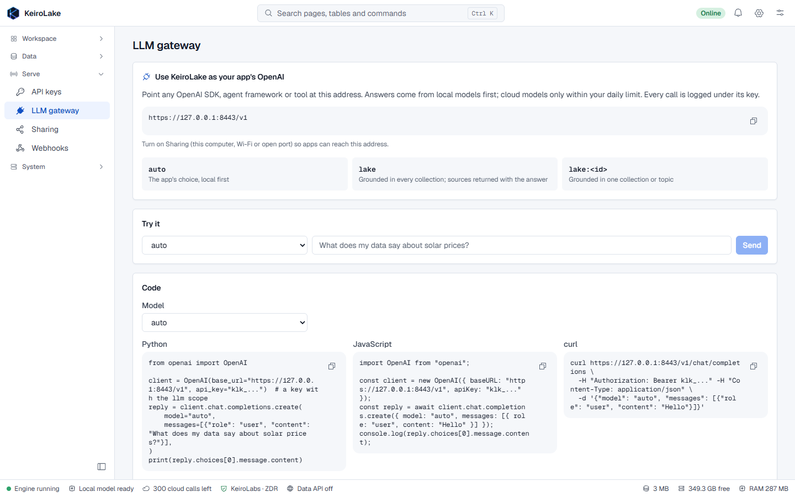

Turn on sharing (even "this computer only"), then make a key under **Serve → API keys** with only the permissions an
app needs:

| Permission | Allows |
|---|---|
| `read` | List and read tables, collections and search |
| `ask` | Ask questions over your data |
| `write` | Add and change rows and documents |
| `sql` | Read-only SQL over your own tables |
| `llm` | The OpenAI-compatible endpoint |

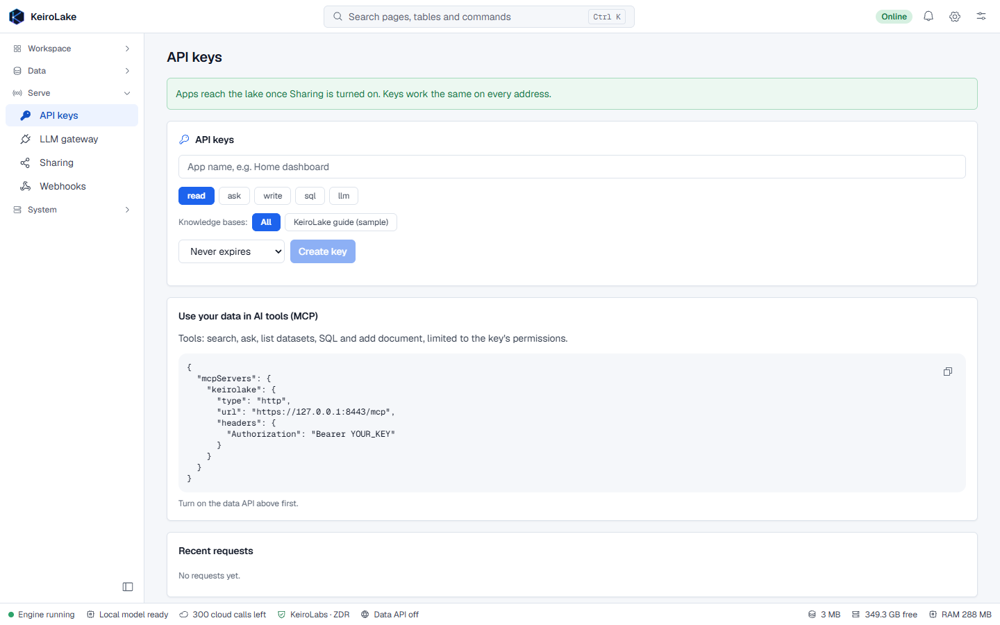

Keys can expire and be revoked, are limited to 120 calls a minute, and every call is logged.

**OpenAI-compatible endpoint** (`/v1`):

```python
from openai import OpenAI

client = OpenAI(base_url="https://127.0.0.1:8443/v1", api_key="klk_...")
client.chat.completions.create(model="auto", messages=[{"role": "user", "content": "Hello"}])
client.chat.completions.create(model="lake", messages=[{"role": "user", "content": "What do my notes say?"}])
client.embeddings.create(model="auto", input=["some text"])
```

`GET /v1/models` lists `auto` (local first), `lake` (answers from all your data, with sources), `lake:<id>` (one
collection or topic), your local models and your cloud models. Streaming works.

**Tables API:**

```bash
curl -H "Authorization: Bearer klk_..." https://127.0.0.1:8443/v1/tables
curl -H "Authorization: Bearer klk_..." "https://127.0.0.1:8443/v1/tables/<id>/rows?where=region:eq:South%20Asia&order=-population&limit=10"
curl -H "Authorization: Bearer klk_..." "https://127.0.0.1:8443/v1/tables/<id>/search?q=large%20coastal%20cities"
curl -H "Authorization: Bearer klk_..." "https://127.0.0.1:8443/v1/views/<name>?format=csv"
```

Add rows with `POST /v1/tables/<id>/rows`, change one with `PATCH /rows/<row id>`, delete with `DELETE`.
Index a table once with `POST /v1/tables/<id>/index` to search it by meaning.

**MCP:** connect any MCP client to `<your address>/mcp` with the header `Authorization: Bearer klk_...`. The tools a
client sees depend on the key's permissions: `list_knowledge_bases`, `search`, `list_datasets`, `query_sql`,
`list_tables`, `read_rows`, `search_table`, `insert_rows`, `update_row`, `list_topics`, `build_topic`, `overview`,
`job_status`, `capture`, `plan_table`, `fill_table` and `list_models`. Apps that can't send a header use the
connector link `<your address>/mcp/k/<key>` instead.

**Webhooks:** get a signed call (HMAC-SHA256 in `X-KeiroLake-Signature`) when an import finishes, a pipeline finishes or a
table is created.

To use these from another device, replace `https://127.0.0.1:8443` with your Wi-Fi address or internet link.

## Backups

**Settings → Data & storage → Backups → Back up now** saves the database, every collection's vectors and a list of your models into a dated folder.
Backups can be encrypted with a passphrase. **Test restore** opens a copy in a temporary folder and checks it without
touching your live data. **Troubleshoot → Copy everything to a drive** copies the database, vectors, lake files and libraries, for moving to another computer.

## Updates

Settings → **Updates** shows your version and whether a newer one is on GitHub.

- **Windows, macOS and AppImage:** **Install and restart** downloads the new version, checks its signature, closes
  the engine, installs and starts again. Your data isn't touched.
- **.deb and .rpm:** **Install update** downloads the new package, checks its signature, and installs it through
  `apt` or `dnf`. Your system asks for your password, like any package update. Then press **Restart KeiroLake**.
- **Server and Docker:** `keirolake update` or the same panel says when there's a new version; pull and restart.

**Check for updates when KeiroLake starts** (on by default) looks at most every six hours. **Install updates
automatically** installs without asking and restarts the app. Nothing about you is sent: the app only reads the public
release list.

## Other ways to run it

### Headless server

For a home server, NAS or cloud VM with no screen. From a clone of the repository:

```bash
(cd frontend && npm ci && npm run build)
pip install -e backend
keirolake serve --share wifi
```

| `--share` | Reachable from |
|---|---|
| `local` | This machine only (`http://127.0.0.1:8443`) |
| `wifi` | Your network, over HTTPS with a certificate made on the machine |
| `internet` | Anywhere, through a private Cloudflare link (`keirolake link` shows it) |
| `open` | A port you open on your router, with HTTPS and an optional allow-list |

Other options: `--port`, `--data <folder>`, `--password-file <file>` (or `KEIROLAKE_PASSWORD`), `--keep-awake`.
The first start asks for the sign-in password. Run it as a service (systemd, Task Scheduler) to start at boot.

### Docker

```bash
KEIROLAKE_PASSWORD='a long password' docker compose -f docker-compose.server.yml up -d --build
```

One container with the engine and web app on port 8443, data in the `keirolake_data` volume. Ollama on the host is
reached at `host.docker.internal`. `KEIROLAKE_SHARE=internet` adds a private link.

### As an app on your phone or another computer

Open your lake's address in a browser and sign in, then **Add to home screen** (phone) or **Install** (Chrome or Edge
address bar). It opens like an app, starts instantly, and says so clearly when the lake can't be reached. Your data is
never stored on the device: only the app's own files are. (Installing needs the internet link, your own address, or
`localhost`: browsers don't install apps from a self-signed Wi-Fi certificate.)

### Capture from your phone

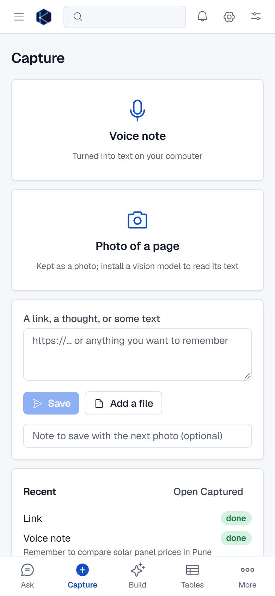

The **Capture** tab (bottom bar on a phone, or Workspace → Capture) puts anything into the lake:

| | What happens |
|---|---|
| **Voice note** | Tap to record, tap to stop. The recording goes to your computer, where a local Whisper model turns it into text (the model, about 145 MB, downloads the first time). The note and the recording are saved. |
| **Photo of a page** | Take or pick a photo. If a vision model is installed in Ollama (for example `qwen2.5vl`), it writes out the text; otherwise the photo is kept with your note. Ollama's cloud models are never used for this. |
| **A link or text** | A link is saved as its readable page; anything else as a note. |
| **Add a file** | PDFs, Word, spreadsheets and more, parsed like any upload. |

Everything goes into a collection called **Captured**, made the first time, and each capture shows its progress under
**Recent**.

- **Share to KeiroLake (Android):** once the app is installed on the home screen, it appears in the share sheet of
  every app. Share a PDF, a page or a photo and it lands in Captured. iPhones don't allow web apps in the share sheet:
  open KeiroLake → Capture instead.
- **No signal:** captures wait on the phone (**Waiting on this device**) and go out by themselves when the lake can be
  reached again. **Send now** retries straight away.
- **Speak instead of typing:** the microphone button in Ask and Build with AI turns what you say into text in the
  message box. Nothing is saved.
- **A better speech model:** set `SPEECH_MODEL=small` for better accuracy (slower), or `SPEECH_DEVICE=cuda` to use an
  NVIDIA GPU.

The microphone, installing the app and the share sheet need trusted HTTPS: the private internet link or your own
address. Over the Wi-Fi address (a self-signed certificate) you can still capture text, photos and files.

### Command line

| Command | Does |
|---|---|
| `keirolake serve` | Run headless |
| `keirolake status` | Version, addresses, internet link, running jobs |
| `keirolake link [on\|off]` | Show, start or stop the internet link |
| `keirolake keys create NAME --scope llm` | Make an API key (printed once); also `list`, `revoke` |
| `keirolake tables` | Your tables and row counts |
| `keirolake build "…" --rows 30` | Plan and fill a table with the AI (`--library` for notes, `--web` for web sources) |
| `keirolake sql "SELECT …"` | Read-only SQL |
| `keirolake ingest`, `chat`, `search` | Add to and ask a collection |
| `keirolake update` | Check for a newer version |

The CLI finds a running `keirolake serve` by itself. For another engine set `KEIROLAKE_URL` (and `KEIROLAKE_TOKEN`).

## Keyboard and display

| Keys | Does |
|---|---|
| Ctrl K | Search pages, tables and commands |
| Ctrl B | Collapse the sidebar |
| Ctrl + / − / 0 | Text size |

The sliders icon (top right) sets the text size, theme (light, dark or system), accent colour (blue, violet, green,
orange or rose), high contrast and reduced motion. Home's **Customise** shows, hides and reorders its panels. The layout works
from phone width up.

## Docs and logs

**System → Docs** has this guide, the list of MCP tools, the data API reference and the logs (engine, vector database
and Ollama), all offline. The log view refreshes every few seconds, can be filtered (try `error`), and never shows keys
or tokens. To send logs with a question, use **Troubleshoot → Support bundle**.

## Troubleshooting

**System → Troubleshoot** checks the database, vectors, disk, internet, local model, cloud keys, libraries and backups,
and says how to fix anything that fails. Common cases:

- **"Local model not ready":** install Ollama, then pick a model under Models.
- **Windows SmartScreen warning when installing:** the installer isn't code-signed yet. Choose **More info → Run anyway**.
- **The internet link doesn't open right after starting:** a new link can take up to a minute to become reachable.
- **Still stuck?** Email [roushan9234620012@gmail.com](mailto:roushan9234620012@gmail.com) with what you see on the
  Troubleshoot page.
